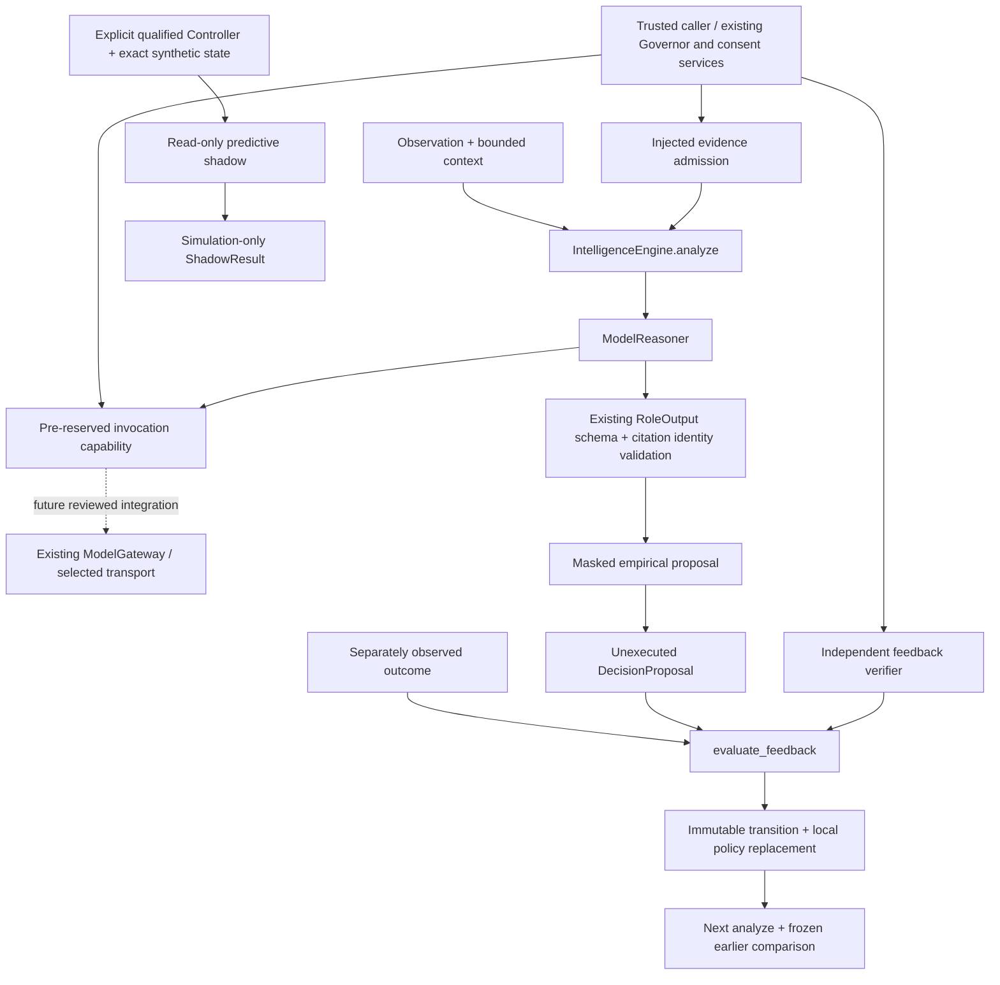

# Design and trust boundaries

There is deliberately no edge from proposal or shadow result to an executor.

## Modules and dependencies

| Module | Responsibility / dependencies |
| --- | --- |
| `contracts` | Versioned immutable Pydantic contracts, bounds, finite values, timezone-aware timestamps and stable JSON hashes. |
| `ports` | Evidence, feedback, authorized invocation and checkpoint verifier protocols. Gateway type import is type-checking-only. No permission factory. |
| `reasoning` | Concrete `ModelReasoner`; existing `RoleOutput`, observer instructions, lazy `StructuredRequest` shape import; validated opinions with admitted citations. |
| `policies.empirical` | Immutable cell state wrapping public `living_policy.choose/update`; explicit controlled/live origin namespace and sample counts. |
| `decision` | Deterministic affordability/candidate mask and proposal. Model-generated actions never enter ranking. |
| `experience` | Pure feedback validation and updated-policy/transition preparation. |
| `engine` | Bounded orchestration, local issued-proposal registry, replay protection, typed failures, revisit and separate shadow query. |
| `policies.predictive` | Lazy NumPy/Controller/environment imports; canonical parameter identity and qualified read-only snapshot. |
| `example` | Explicit zero-token fixture ports and independently supplied fixture feedback; no production wiring. |

Core dependencies point into existing stable pure contracts/functions. No core,
Pi, learning or experiment module imports Intelligence. The package-root import
loads neither gateway/providers nor Controller/Pi/DB. Standard library and existing
Pydantic are sufficient for the active path; existing NumPy is optional for shadow.
No new dependency, registry, container, singleton, daemon or inference owner exists.

## Contracts

| Contract | Identity and qualifications |
| --- | --- |
| `Evidence` / `Observation` | Event/episode/goal identity, source ID/fingerprint, observed time, origin, trust, current/historical/unqualified status, bounded safe text. |
| `Context` / `History` | Exact evidence sent to reasoner; explicit compatible state, candidate set, goal/scope/policy, reported resources, dated qualified history and split. |
| `CandidateAction` | Stable candidate ID, allowed action vocabulary, expected benefit/cost/risk, always a proposal. |
| `ReasoningResult` / `Claim` | Trusted invocation provenance/usage/receipt, visible summary, limitations and recommendation. Every claim is model opinion with nonempty admitted citations. |
| `DecisionProposal` | State and policy hashes, candidate IDs, chosen candidate or abstention, observed mean/sample count/uncertainty, invocation, external authorization required, always `executed=False`. |
| `OutcomeFeedback` / `RewardComponent` | Unique observed outcome, exact episode/proposal/goal/action, execution/completion, independent current measurements, bounded observed reward, event time, origin/split. |
| `ExperienceTransition` | Before-state, proposed/executed distinction, outcome, policy before/after identities and sample counts, provenance/split/usage and optional saved-estimate error. |
| `RunResult` / `TraceEvent` | Proposed/abstained/failed/cancelled, bounded public explanation/error code, chronological stage summaries and references. No hidden reasoning or exception payloads. |
| `FeedbackResult` / `RevisitResult` / `ShadowResult` | Typed accepted/rejected/duplicate/failed local update, current/frozen comparison, or separate simulation-only predictions/unavailability. |

Frozen nested types are revalidated at API boundaries. Source hashes identify
snapshots; they do not certify source truth, authority, quotation or semantic
entailment. The exact structured gateway schema is the existing `RoleOutput`;
Intelligence does not copy its action/role contracts or its source checking logic.
The local `Claim` adds immutable tuples and an explicit model-opinion tag after
existing schema validation. It never promotes an opinion to independently verified
fact or marks generated text as an exact quotation.

## Actor responsibilities and sequence

1. **Trusted caller** selects the goal, explicit Aster state, candidates, split and
   origin; supplies safe input and authorized evidence/history adapters. A permitted
   candidate means eligible for consideration, not permission to execute it.
2. **Evidence port** reconciles source records, timestamps, access control, goal scope,
   historical qualifications and safe outbound payload. It must authorize the whole
   observation/context, including history and safe text, and return exact evidence.
   Engine additionally rejects identity conflicts, unsupported provenance, future
   evidence, omitted observation sources and cross-origin/split history.
3. **Caller capability** exists only after real consent/reservation and exact request
   approval. Engine checks its structural interface and data/scope binding. Those
   checks do not authenticate arbitrary Python objects. The capability enforces the
   complete request and one-use semantics, dispatches via an approved existing
   gateway, and owns settlement on success, rejection, timeout or cancellation.
4. **Reasoner** validates bounded response, existing strict role schema, finite
   confidence, invocation identity and citations. Caller-provided provider/model/
   receipt/usage metadata is retained. Actions are ignored. Only an explicit model
   abstention can reduce the policy recommendation to abstention.
5. **Decision layer** calls existing empirical ranking, restricts it to the candidate
   set and reported affordability, and records a deterministic unexecuted proposal.
   A policy change or conflicting episode during an asynchronous call fails closed.
6. **Independent observer** supplies what actually executed and measured results;
   no predicted reward may enter feedback. Trusted verifier checks against external
   records, rather than trusting text flags. Validation rejects missing provenance,
   wrong IDs/actions, incomplete outcomes, origin/split leakage and stale policies.
7. **Experience layer** prepares new state and the immutable transition; **engine**
   replaces its local state and consumes both outcome and proposal identity without
   an await or external write. Failed preparation publishes no success or update.
8. **Revisit** uses a new episode and externally supplied related context/history.
   It compares current policy with a retained immutable earlier policy, applying
   the same new masks/resources to both. This is a policy comparison, not a causal
   benchmark or evidence of improved generalization.

## Integration seams intentionally unimplemented

The inspected Cognition call path reserves and charges through `ModelInvocation`
and Governor accounting before constructing `StructuredRequest`; it owns settlement.
`gateway_for` currently accepts only `cognition.role`, selecting direct transport
or Pi from approved settings. Intelligence never calls it. Existing Pi runtime,
egress, lifecycle and receipt recovery remain untouched. The older `alive.agents`
Pi RPC runner is a separate system and is not reused or conflated with `alive.pi`.

A future capability must bridge a real reservation and approved operation to the
request, wrap gateway `Generation` with actual invocation/provider/model/receipt/
usage identity, and retain upstream settlement behavior. Current `Generation`
alone lacks those identities. A role reservation cannot simply be reused for an
unapproved Intelligence payload. No new operation is registered or allow-list
relaxed here, and no capability can be manufactured from a reservation string.

Persistence would require an existing-service atomic transaction over policy,
accepted outcome IDs and transition. An arbitrary save callback cannot provide
that guarantee; none is offered. Session deduplication is bounded, conservative
(at most one accepted outcome per proposal) and intentionally not durable. The
engine is intended for one event loop, not concurrent operating-system threads.

The predictor requires an independently qualified existing artifact and explicit
synthetic feature ordering. No semantic state encoder, checkpoint loader, live
policy promotion or predictive reward training hook exists. No qualification of
its positive checkpoint path, live transfer or comparative advantage is claimed.

## Failure and privacy behavior

No authorized reasoning produces an abstention, not a successful model result.
Malformed contracts, unknown citations, extra model fields and adapter failures
produce bounded failures; unsupported empirical actions have `not_supported`.
Cancellation returns `cancelled` with no issued proposal. No retry or detached
background task is created. The trusted capability must cooperate with timeout
and cancellation and account for any already-dispatched request; this engine
cannot forcibly stop a hostile in-process adapter.

Trace entries contain stages, safe summaries and IDs. Raw provider responses,
exception strings, hidden reasoning and secrets are not placed in traces. Validated
visible model summaries remain untrusted text. Input redaction and outbound consent
belong to the existing host services; no heuristic secret detector is substituted.
