# ALIVE-02: implementation design

ALIVE-02 extends the ALIVE-01 identity, event log, goals, memories, authentication, ZeroMQ, browser control and React observatory. It does not introduce a second goal store or replace the original dashboard.

## Executed path

```mermaid
flowchart LR
  Page[Authorised DOM change] --> Log[(Existing event log)]
  Log --> Triage[Normalise, redact, deduplicate]
  Triage --> Attention[Deterministic attention and auction]
  Attention -->|below threshold| Ignore[NO ACTION WARRANTED]
  Attention -->|reserve hard budget| Goal[Existing goal + investigation]
  Goal --> World[Versioned explicit world snapshot]
  World --> Observer[Observer: model]
  Observer --> Proposer[Proposer: model]
  Proposer --> Critic[Critic: model, configurable ablation]
  Critic --> Investigator[Scoped read-only evidence lookup]
  Investigator --> Evaluator[Deterministic source checks]
  Evaluator --> Governor[Permissions and state machine]
  Governor --> Approval[Human approval when required]
  Governor --> Outcome[Atomic internal or controlled local effect]
  Approval --> Outcome
  Outcome --> Experience[(Validated experience + persistent budget settlement)]
```

`Cognition` owns a bounded event scan and one worker, under ALIVE's existing database scheduler ownership. It reads events in batches of 100 through a persisted cursor; subscriptions remain ephemeral notifications, not cognitive truth. Each normalized observation references its original source event. A unique fingerprint and unique observation/investigation relationship suppress duplicate work. The queue is capped at 128; expired and budget-rejected bids are recorded explicitly.

The managed browser sensor is separately authorised through `POST /api/v1/browser/sessions/{id}/observation` with `approved=true`. It samples visible DOM text every 500 ms, compares against its previous observation and uses the existing safe text extraction. The Chrome extension remains another authorised event source. Page data never chooses provider configuration, tools, budgets or action authority.

## World state and independent evidence

Each investigation persists a schema-versioned snapshot: observation and event IDs, parsed claims, environment/version, relevant historical memories with provenance, active/accepted goals, remaining session budget, recent outcomes, source facts, timestamp and hash. This is a diagnostic state record, not an embedding pretending to represent the world.

Controlled laboratory claims use a generic `Claim: subject | predicate | value;` representation. The laboratory separately stores seeded instrument measurements. The roles can inspect the authorised source facts; the deterministic Investigator rereads them and checks the environment version before evaluation. Model prompts do not contain scenario IDs, expected verdicts or reward labels. General prose can be investigated, but absent independent measurements the evaluator retains uncertainty. This milestone's independent verification is deliberately limited to controlled sources.

Memory generated from the observation itself is excluded from its retrieval context. Model-generated analysis is tagged as such and is never treated as an independent measurement. Repeated agreement across model roles cannot turn an unsupported claim into verified evidence.

## State and recovery

Persisted history begins `OBSERVED → TRIAGED → GOAL_PROPOSED → SCHEDULED`, then follows validated transitions through `INVESTIGATING`, optional `CRITIQUING`, `EVALUATING`, `AWAITING_APPROVAL`, `EXECUTING` and a terminal state. Terminal states are `COMPLETED`, `ABSTAINED`, `FAILED`, `CANCELLED`. Each transition emits a correlated event.

On interruption, active work is cancelled and recorded as truncated experience with its already charged inference cost. Unknown in-flight requests retain their pessimistic reservation; there are no free inference retries. Previously running autonomy resumes **paused**, not silently active. Pending approval records survive without executing. Completed effects are never replayed. Identity, goals, observations, investigations, messages, usage and experience remain persistent.

Pause/stop cancels the active worker, cancels queued bids and retains useful partial evidence. Stop also revokes managed sensors. Suspending the original ALIVE runtime pauses cognition and revokes its sensors. Resuming cognition is an explicit authenticated operation.

## Schema and code

Migration **0003** adds `cognitive_control`, `cognitive_observations`, `investigations`, `model_invocations`, `cognitive_messages`, `action_proposals`, `experiences`, `memory_vectors`, `history_imports`, `laboratory_environments`. The sidecar vector store has model/revision/dimension provenance and a PostgreSQL `vector(384)`/HNSW cosine column where pgvector exists. Original ALIVE-01 embeddings and history remain intact.

Core implementation: `alive/attention.py`, `cognition.py`, `cognitive_schema.py`, `cognitive_models.py`, `cognitive_api.py`, `society.py`, `memory.py`, `laboratory.py`. The React `CognitionPane` adds real budget/control, attention, messages, world state, approvals and experience views alongside the existing sections.

This is deterministic control plus model-generated interpretation/proposals. It implements no reinforcement learning, MR.Q training, consciousness or autonomous self-improvement.
