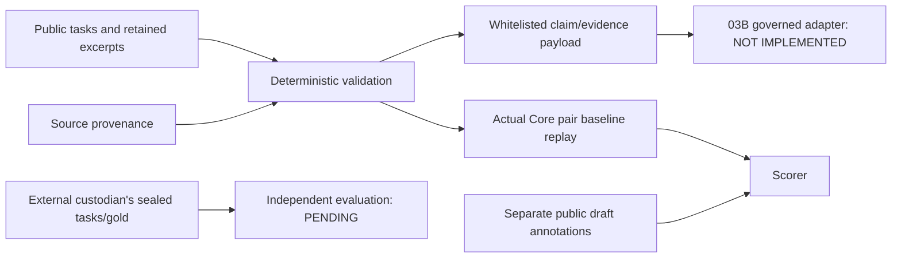

# ALIVE-NOTEBOOK-03A — design

Baseline: `a9bcf8673818e85246a268c308b64d2080792b96`, merged PR #44 verified before
branch creation. Branch: `codex/alive-notebook-03a-semantic-protocol`.
Authority: offline experimental infrastructure only. Zero model inference; no 03B work.

## Boundary and plan

Use a separate evaluation module/CLI under `scripts/` and fixtures under
`evaluations/notebook03a/`. Do not change production qualification, retrieval, permissions,
Governor, source documents or old experiments. Reuse actual Core APIs for pair baselines;
keep task schemas, annotation/scoring and payload preparation independent of Core/model code.

1. Define strict claim/source/task, annotation and proposed prediction schemas.
2. Prepare 40 public cases (authentic history plus labelled controlled perturbations).
3. Validate exact source/quote bindings, split families, completeness and payload whitelists.
4. Freeze inputs, annotation provenance, prompts and metrics before baseline replay.
5. Replay existing lexical and integrity APIs without inference; score actual recorded actions.
6. Publish evidence, tests, design/protocol/report and draft PR. Stop for Claude review.

## Orthogonal taxonomy

Relationship: supersession, contradiction_candidate, corroboration_candidate, scoped_change,
substantive_connection, independent_observations, unsupported_claim, unknown.
Sufficiency: sufficient_for_candidate / insufficient / unknown.
Applicability: applicable / scoped / not_applicable / unknown.
Research decision: use_with_qualification / set_aside / abstain. Baseline-only actions
retain_candidate, refuse and not_applicable are distinct from semantic findings.

Specific categories take priority over substantive_connection (a residual meaningful link).
Supersession needs explicit replacement of a particular policy/proposition, not a date.
Contradiction needs incompatible propositions under comparable conditions; differing
conditions use scoped_change. Corroboration needs genuinely additional matching evidence;
verbatim duplicated claims alone are not independent corroboration and use a residual
connection with that limitation. Independent_observations describes an adequately supported
lack of a substantive link; unknown with insufficient evidence describes epistemic inability
to decide. Unsupported_claim compares an identifiable assertion with its supporting passage,
including within one source. It can be a useful correction and a set_aside decision, rather
than automatically counting every negative finding as abstention.

Claims carry exact passage references and optional proposition/qualifier/version/system
context. Unknown fields remain null; no inferred answer-bearing proposition is inserted into
inputs. Sources have excerpt hashes and separate pinned document provenance. Authentic
source quotations are checked against Git objects, not just fixture copies. Synthetic and
controlled text is explicitly identified in provenance, not presented as historical truth.

## Leakage and independence

Public development and public evaluation cases, gold annotations, annotation notes and
baseline outputs are separate files. Both public splits are IMPLEMENTER_EXPOSED, not blind.
Family and duplicate-source checks prevent known variants crossing public splits. Prepared
payloads whitelist source text/hash, claim text/spans, context and question; they also withhold annotation-selected supporting-span hints and omit task
IDs, split, family, provenance labels, annotation notes and gold. Structural checks cannot
detect all semantic leakage or prove labels correct; independent review is necessary.

Target total: 52 cases (40 public and 12 independently authored held-out cases). The 12 are
not invented or counted as available cases. Status: PENDING_INDEPENDENT_LABELING. An external
custodian must author/adjudicate and retain task/gold packages in an account or machine the
03B implementer cannot access. No sealed gold is committed here. A package outside this
repository is not sufficient evidence of access restriction. The custodian runs validation
and scoring, shares hashes/aggregate reports only, and records access attestations. Exposure
of answers invalidates blind use for subsequent tuning. Schema/manifest checks validate
attestations, not OS permissions or real human identities; no blindness is currently claimed.

## Governance and dependencies for 03B

Existing `research/outbound/preview -> authorize -> analyze` binds exact payload/provider/
model/source hashes to consent. ResearchRelationships revalidates live current grant,
active same-goal history, consent/payload hashes, experiment approvals and budgets. Startup
marks interrupted attempts and accounts for dispatch ambiguity. Existing claim comparison
requires reliance anchors and distinct source pages. It is not a general single-source
claim-support adapter or this new output schema.

03B therefore needs a reviewed adapter to existing governance, not a direct HTTP client:
exact serialized evidence plus prompt/schema/model/settings preview; approval of that exact
request; persisted caps, cancellation and restart state; source revalidation; structured
output/citation checking; usage ledger. Single-source R4 and schema/request identity binding
must be qualified before dispatch. 03A provides no dispatcher, consent issuer or approval.
Model-output import/execution is disabled in the CLI; pure scoring tests are offline fixtures.
A future production operation must accept owned snapshot/memory IDs plus claim spans,
resolve them through Core, and build the whitelisted payload server-side. The fixture
`access` fields are declared experimental conditions, never production authorization proof.
Natural-language rationale, scope and forbidden-conclusion compliance require independent
03B output adjudication. Matching category/conditions/citations is only a provisional
operational score; an exact quote cannot prove entailment of arbitrary prose.

Carry-forward risk register (production API is unchanged in 03A):

| Issue | Decision before 03B consumes it |
|---|---|
| Aggregate quote status includes unrelated source failures | dependency: new versioned per-source requested-quote status; do not use aggregate as consent/citation proof |
| Missing historical source can mask current hash mismatch | dependency: preserve per-source integrity outcomes; fail any mismatch, not one precedence enum |
| Historical title drift blocks body while current title drift does not | dependency: separate presentation consistency from body/quote validity in a narrow migration |
| Occurrence counts cover only bounded excerpts | dependency: explicit scope/offset units; no full-document uniqueness claim |
| Historical derived metrics lack a committed expectation comparison in CI | add deterministic public baseline expectation checks here; the old derived-report gate remains a separate narrow follow-up |

Other risks: implementer-authored labels, synthetic template families, small samples,
incomplete external holdout, partial captured context, provisional annotation judgments,
no independent authenticity proof, no measured semantic performance. Independent label
adjudication and a separately authorized model experiment remain hard prerequisites.
