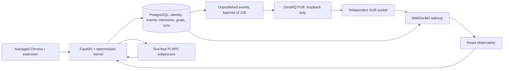

# Architecture

The FastAPI process owns one ALIVE instance, a lightweight heartbeat scheduler, a transactional event log, a bounded outbox worker, an independent ZeroMQ subscriber, browser contexts and supervised Pi processes.

## Persistence and delivery

Alembic migrations create explicit tables, foreign keys, goal/run status constraints, score bounds, event ordering/correlation indexes, PostgreSQL generated full-text documents and a GIN index. The first vector dimension is 384, reserved for a future MiniLM-class embedding model. No embedding model runs today; semantic search returns an explicit 409. pgvector storage capability and semantic search capability are reported separately.

Observation ingestion commits its event, memory, proposed goal and novelty state in one transaction. A unique event identity makes retries idempotent. The outbox scans up to 100 unattempted events in sequence order. `published_at` records a successful **publication attempt**, not subscriber acknowledgement. A crash between publish and commit may cause a duplicate. PUB/SUB can lose messages; it is never presented as a durable queue.

The dashboard authenticates its WebSocket in its first frame and supplies the last sequence cursor. The server reads persisted history and reconciles every second, with ZeroMQ subscriber events waking it sooner. A bounded subscriber queue can drop wakeups without losing database history. The HTTP history endpoint offers the same sequence recovery. The UI deduplicates by event ID and retains its latest 300 events.

## Ownership and recovery

A dedicated PostgreSQL connection holds an advisory lock for the runtime's life. SQLite development uses a database-specific OS file lock. A second owner starts in degraded mode and cannot mutate the runtime. One async lock serializes kernel mutations inside the owner. The heartbeat checks the PostgreSQL lock connection before updating state; worker failures mark the runtime unavailable. This is a single-owner local runtime, not distributed leader election or a multi-tenant service.

On restart the identity and lifecycle state persist. Old browser sessions close in the database; interrupted agent runs become failed. Accepted unfinished goals and novelty hashes survive. Browser profiles and live subprocesses are deliberately not restored. `alive.started` records process recovery; starting/suspending the runtime controls its scheduler and drives.

## Policies and authority

Curiosity stores novel visible text and proposes an investigation while running. Coherence records repeats and explicit expected-text mismatches. Commitment refreshes accepted/active goal IDs at each heartbeat. These are transparent deterministic policies, not learning algorithms. A suspended runtime may still accept explicitly submitted observations and user-controlled agent/browser requests; it does not propose curiosity goals or schedule heartbeats.

Proposed goals require explicit acceptance. Nothing automatically executes webpage instructions. Pi receives a controlled objective as untrusted data, runs from `.alive/agent-workspace`, and has tools, MCP, extensions, skills, context files and prompt templates disabled. Its newline-delimited RPC input/output is supervised, bounded by a timeout, streamed through whitelisted progress fields, persisted and terminated on cancellation/shutdown.

Browser contexts are separate from normal profiles. Every network request is checked against exact configured origins; service workers and downloads are disabled. Click/fill require `data-alive-allow="click"` or `"fill"`. Password/hidden/payment fields and private subtrees are denied. Visible-text capture excludes forms and hidden/private subtrees. URL query strings/fragments are omitted from observations. Screenshots are restricted to the demonstration path.

## Model providers

`ModelProvider` defines IDs, capabilities, generation, structured decisions and streamed output. The deterministic mock is exercised offline. The environment-driven Meta adapter targets an explicitly configured compatible backend gateway; no endpoint, model or credentials are assumed. It records usage and latency, reports vision/native streaming unavailable, and offers a documented buffered streaming fallback. Actual Meta inference and embeddings remain unverified until configured.
